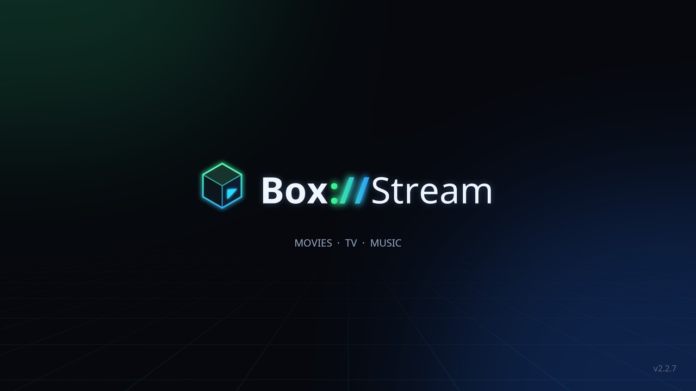
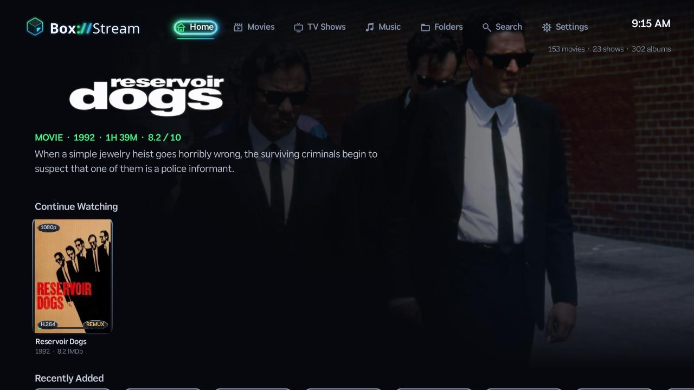
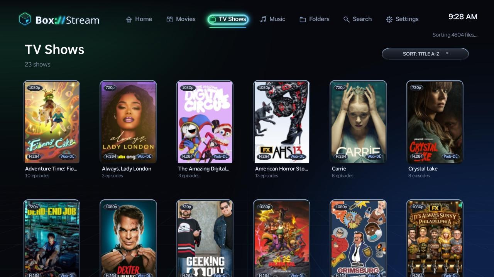
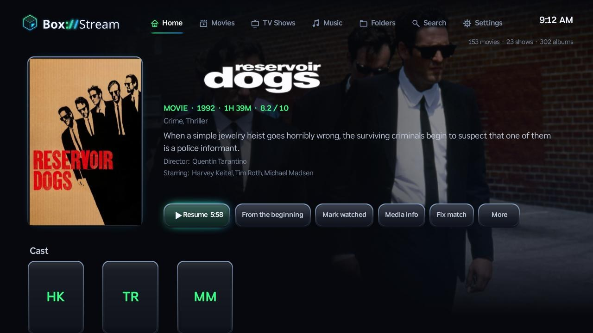
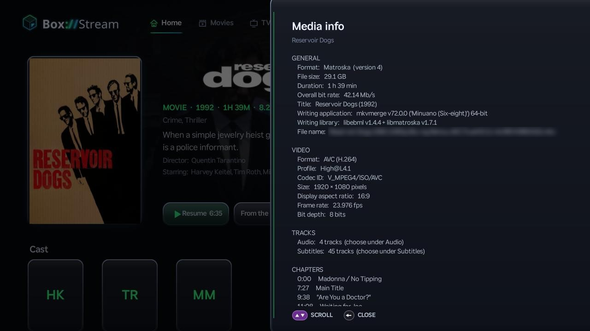
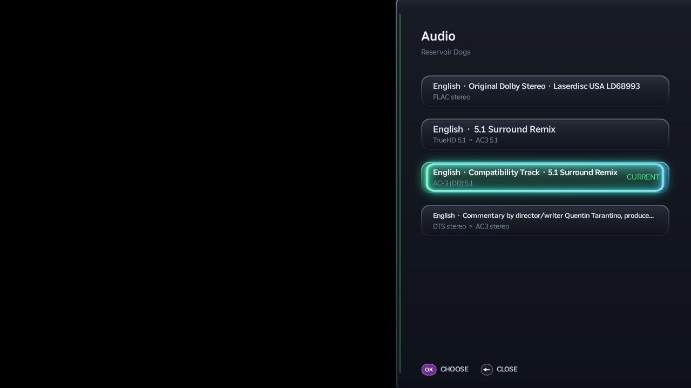
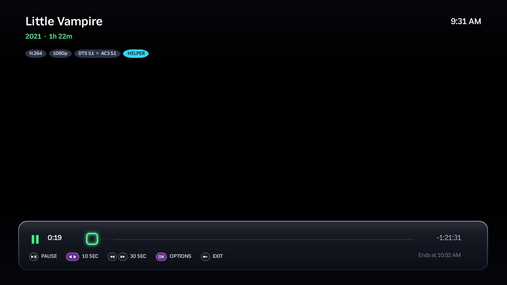
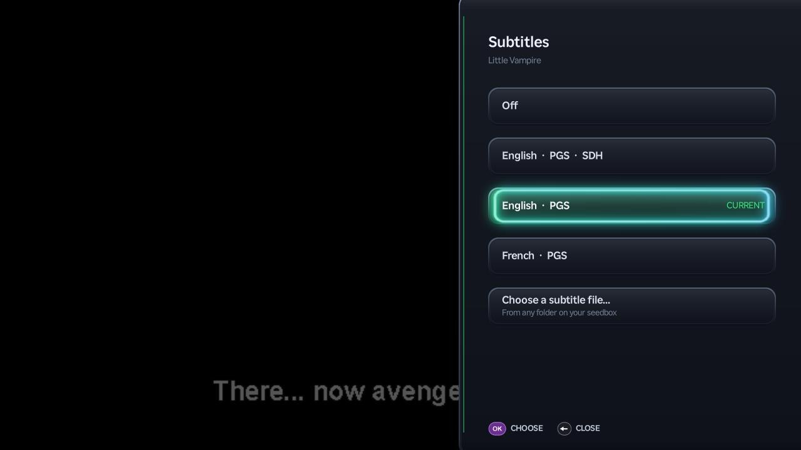
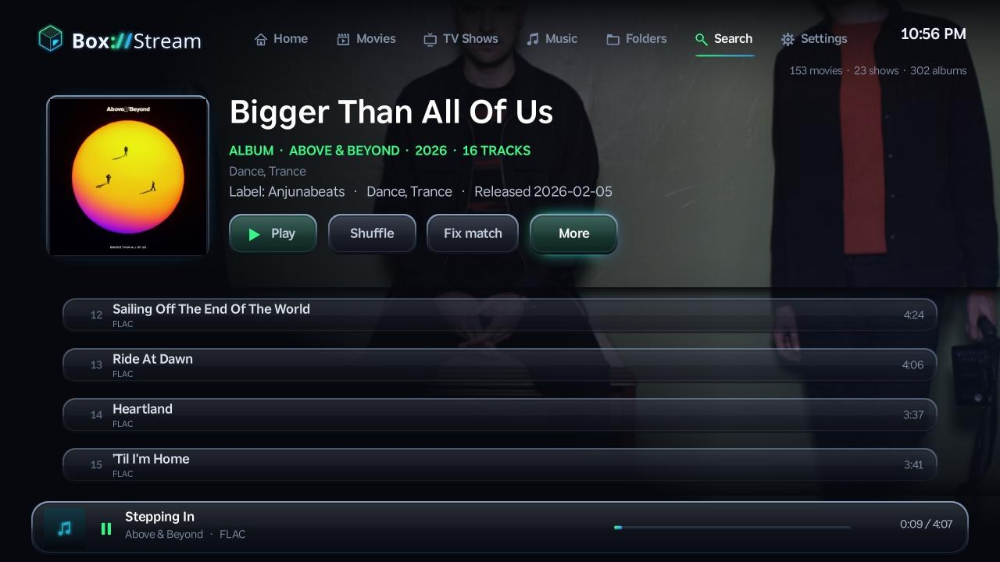

<p align="center"></p>
<h1 align="center">Box://Stream</h1>
<p align="center"><strong>Your seedbox, as a Roku streaming library</strong></p>
<p align="center">Movies · TV Shows · Music · Subtitles · Optional DTS / TrueHD helper · Version 2.2.7</p>

> **Your own files, your own server.** Box://Stream doesn't host, find or supply any media. It plays what is already on a server you control, such as a seedbox or any web server that lists its folders, and streams it straight to your Roku.

Box://Stream reads your server's folder listings and builds a library of **Movies**, **TV Shows** and **Music**, with posters, plots and cast. Point it at the folder you'd open in a web browser and it sorts everything out: movies, shows by season and episode, and albums with their songs. Nothing is uploaded anywhere.


<p align="center"><em>The 2.2.7 splash screen, as packaged in the Roku ZIP.</em></p>

## Download and install

| Package | What you get | Download |
| --- | --- | --- |
| **Roku ZIP** | The Roku TV app; upload this ZIP directly to your Roku | [boxstream-v2.2.7-roku.zip](https://github.com/snuffy420/BoxStream/releases/download/v2.2.7/boxstream-v2.2.7-roku.zip) |
| **Helper setup** | The optional helper's one-command Oracle Cloud setup | [boxstream-setup.sh](https://github.com/snuffy420/BoxStream/releases/download/v2.2.7/boxstream-setup.sh) |
| **Source 7z** | Editable BrightScript, artwork, helper, build tools and documentation | [boxstream-v2.2.7-source.7z](https://github.com/snuffy420/BoxStream/releases/download/v2.2.7/boxstream-v2.2.7-source.7z) |

Checksums (`.sha256`) sit beside every download on the [release page](https://github.com/snuffy420/BoxStream/releases/tag/v2.2.7). The source archive is for development; the Roku installer needs the Roku ZIP.

### Install on Roku

1. Enable Developer Mode: press **Home** three times, **Up** twice, then **Right, Left, Right, Left, Right**. Follow the TV prompts, set an installer password, and note the Roku IP address.
2. From a computer on the same network, open `http://ROKU_IP` in your browser.
3. Sign in as `rokudev` using your installer password.
4. Select **Upload**, choose `boxstream-v2.2.7-roku.zip`, then select **Install**.
5. Open **Box://Stream**. Installing a newer ZIP the same way keeps your settings, library and poster choices; removing the app deletes them.

See [Roku's developer setup](https://developer.roku.com/docs/developer-program/getting-started/developer-setup.md) for the official instructions.

### Add your server

Open **Settings > Sources** and enter the web address of the folder that holds your files (the page that lists them in a browser), plus its username and password if it has them. The Roku mobile app's keyboard makes typing easier. The first scan reads every folder; after that only changes are checked.

## Explore Box://Stream

### Your folders become a library

Home opens on what you were watching and what was added last, with the selected title's artwork filling the screen. Posters, plots and cast come from IMDb data (via Cinemeta), TVmaze and Deezer, but your own `folder.jpg`, cover and poster images always come first. A wrong match can be fixed and anything can be hidden. Several sources can feed one library.



The library is saved on the Roku, so it shows straight away at launch and survives updates. New, changed and removed files are picked up on start and every 30 minutes.



### Movie and show pages

Each title has a details page with resume, start over, versions of the same movie, media info, fix match and more. Episodes have Up Next. The buttons size themselves to fit the screen.



### Media info

Box://Stream reads the technical details straight from each file's own headers, so what it shows is the real file, not a guess from its name. **Media info** opens a MediaInfo-style sheet:

- **General:** container format, file size, duration, overall bit rate, title and the tools that made the file.
- **Video:** codec and profile, resolution, aspect ratio, frame rate and bit depth, plus HDR format, color primaries, color range and light levels on HDR files.
- **Tracks and chapters:** how many audio and subtitle tracks there are, and the chapter list with times and names.

The same details drive the resolution, codec, HDR, 10-bit and REMUX tags on the posters, and the warning before a file your Roku can't decode. While a movie plays, **OK > Media info** also shows your network speed.



### Audio tracks, chosen sensibly

Your language is remembered. In it, a track your Roku plays (such as a Dolby Digital compatibility track) comes before one that needs converting, and commentary and description tracks are skipped unless you pick them. The Audio menu shows each track's full name and what happens to it.



### The play bar

The play bar shows what is playing like a regular player: video codec, resolution, HDR and bit depth, and the audio track. When the helper converts the audio, a **HELPER** badge shows it.



### Subtitles

SRT, WebVTT, ASS/SSA, PGS (Blu-ray), VobSub (DVD) and text tracks inside MKV files, including right-to-left and non-Latin scripts. "Loading subtitles..." shows while a track loads. **Choose a subtitle file...** picks one from anywhere on your server, and the choice is remembered for that movie.



### Music

Album pages with gapless playback, seeking, song lengths read from the files, and a player bar with the album art. Music keeps playing while you browse the rest of the app.



### Search and Folders

Search finds titles, actors, directors, artists and genres across everything. **Folders** is a plain view of your server, for anything the library doesn't sort.

## The optional helper (DTS, TrueHD, hi-res FLAC)

Most Rokus can't play DTS or Dolby TrueHD audio, and some play FLAC above 48 kHz slowed down. The **helper** is your own small server that converts just that audio:

- DTS and TrueHD become Dolby Digital. Stereo stays stereo and 7.1 becomes 5.1, or everything becomes stereo with **Settings > Helper > Converted audio in stereo** on.
- Hi-res FLAC becomes 48 kHz.

It runs on Oracle Cloud's free tier and is set up with one command in Oracle Cloud Shell, which creates the server and prints its address and a pairing code. Video never goes through it, and it only converts what your Roku can't play. Each server gets a random plain name, and `--remove NAME` deletes it again. See [helper/README.md](helper/README.md) and the step-by-step [INSTALL.txt](INSTALL.txt).

If your Roku passes DTS through to a receiver, it plays DTS as it is; the app detects that by itself.

## What plays

- **Video:** depends on the Roku. H.264 up to 1080p plays everywhere. HEVC, 4K and AV1 need a Roku that decodes them; the app warns before playing a file yours can't, and offers another version if you have one.
- **Audio:** AAC, Dolby Digital, Dolby Digital Plus, FLAC, PCM, MP3, Opus and Vorbis play directly. DTS, TrueHD and FLAC above 48 kHz play through the helper.

Your exact list is under **Settings > This Roku can play**, with a green **CONNECTED** mark when your helper is reachable.

## Controls

| Screen | Remote controls |
| --- | --- |
| **Browsing** | Arrows move; OK opens; * options (sort, fix match, hide); Back goes back |
| **Details** | Left/Right choose a button; OK selects; Down to cast, seasons or songs |
| **Watching** | OK playback options (subtitles, audio, media info); Play/Pause pause; Left/Right 10 seconds; REW/FF 30 seconds, more with each press; Up/Down show the play bar; Back stops |
| **Music** | Play/Pause pauses or resumes the song while you browse |
| **Keyboard** | OK types; * caps lock; Replay deletes; Play/Pause done |

## Privacy

- Your files are read from your own server; nothing is uploaded anywhere.
- Logins stay on the Roku and are only sent to the server they belong to.
- Title searches go to the services that provide posters and details.
- If you use a helper, it reads only the audio of the file being converted. The server login is passed to it per request and never stored.

## Development and license

```bash
python tools/package.py
```

Packaging needs Python 3.12 with Pillow, plus Node.js with the `qrcode` package for the About page's QR code (set `BOXSTREAM_NODE_MODULES` to its `node_modules` folder). The ZIP lands in `releases/`. `python tools/build_setup.py` rebuilds the helper's one-file setup script, and `python tools/release.py` builds everything for a GitHub release. [Release notes](CHANGELOG.md) describe each version.

Box://Stream's code and original artwork are licensed under [GPL-3.0](LICENSE). Fonts and data from other sources keep their own terms; see [THIRD_PARTY.md](THIRD_PARTY.md). Box://Stream is an independent project, not affiliated with Roku, Oracle or any of the services it reads from.

## Support Box://Stream

If Box://Stream is useful to you, you can support its development with a Bitcoin donation. Donations are optional and appreciated.

**Bitcoin (BTC):**  `bc1qz8877p6vusc22qrctdj4h7w0uk2l9l9h8lwphy`

## Contact

Questions, feedback, a bug report or a custom build? Get in touch through the Box://Stream contact form.

<p align="center">
  <a href="https://snuffy420.github.io/BoxStream/docs/contact.html">
    
  </a>
</p>
